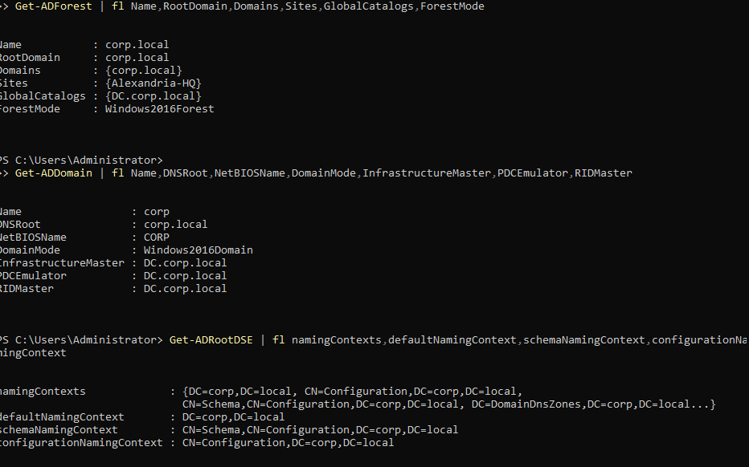

# Forest, Tree, Domain, and OU

My way of remembering the structure is to start with the forest and work downward.

- **Forest:** The complete AD environment. It can contain one or more domain trees. Domains in the same forest share a schema, configuration, and global catalog, and have automatic two-way transitive trusts. In this lab, the forest is `corp.local` and currently contains one domain.
- **Tree:** A hierarchy of domains whose DNS names form a continuous namespace. For example, if `corp.com` is a root domain, *actual AD child domains* could be `east.corp.com` and `west.corp.com`. A DNS record or DNS subdomain alone is not an AD child domain: creating the child domain requires deploying AD DS for it. A forest can contain multiple trees with different namespaces.
- **Domain:** A directory partition and administrative scope for users, computers, and groups, served by its domain controllers. It is possible to apply domain-specific policies and delegate management. A domain is not a separate security boundary equivalent to a forest: forest-level administrators and shared forest components can affect its security.
- **OU (organizational unit):** A container *inside one domain* that organizes AD objects. I use OUs to group people and computers by where I want to apply Group Policy or delegate management. For example, `OU=HR,OU=Users,OU=Corp,DC=corp,DC=local` holds HR user objects. An OU is not a security group: putting a user in an OU does not grant access to a file share.

## How I checked it in this lab

`Get-ADForest` showed one forest and domain, site `Alexandria-HQ`, global catalog `DC.corp.local`, and forest mode `Windows2016Forest`. `Get-ADDomain` showed `CORP`, domain mode `Windows2016Domain`, and three displayed FSMO role holders on `DC.corp.local`. `Get-ADRootDSE` exposed the domain, configuration, and schema naming contexts. ADSI Edit displayed each one and references to the `DomainDnsZones` and `ForestDnsZones` application partitions.

## Naming contexts, in plain terms

The **domain** context holds objects for this domain; the **schema** specifies object classes and attributes; and **configuration** holds forest-wide configuration. DNS application partitions store AD-integrated DNS data with their own replication scopes. These are directory partitions, not separate forests.

Source for technical distinctions: [Microsoft Learn — Active Directory logical model](https://learn.microsoft.com/en-us/windows-server/identity/ad-ds/plan/understanding-the-active-directory-logical-model) and [Domain trees](https://learn.microsoft.com/en-us/windows/win32/ad/domain-trees).
