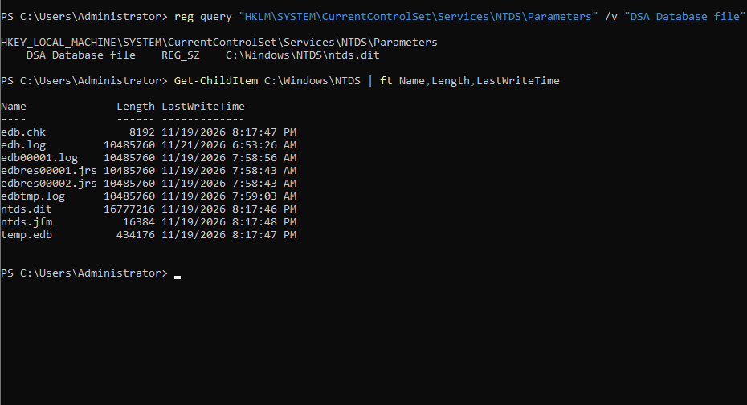

# NTDS.dit and its supporting files

I think of `ntds.dit` as the domain controller's AD database. It stores directory objects such as users, computers, and groups, including sensitive credential material. That makes the database and its backups especially important to protect; a directory listing alone does not reveal any account's password.

| File observed in the lab | What it does |
|---|---|
| `ntds.dit` | Main directory database. |
| `edb.log` | Current transaction log: records database operations before they are committed to the database. |
| `edb.chk` | Checkpoint: tracks progress through the transaction logs for database recovery. |
| `temp.edb` | Temporary database used by the database engine for intermediate work. |

The registry value `DSA Database file` pointed to `C:\Windows\NTDS\ntds.dit`, and `Get-ChildItem C:\Windows\NTDS` showed these files along with other database engine files. I inspected the path and file names; I did not document an IFM export, a shadow copy, or an attempt to read a live database file.

Source for the file roles: [Microsoft Learn — Extensible Storage Engine files](https://learn.microsoft.com/en-us/windows/win32/extensible-storage-engine/extensible-storage-engine-files).
