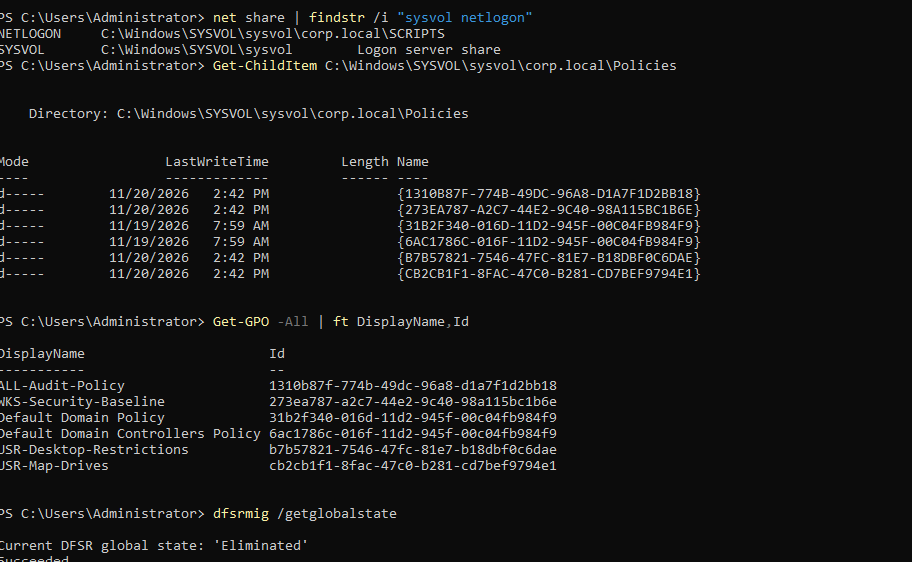

# SYSVOL and Group Policy

I think of SYSVOL as the shared location where domain controllers publish policy files and sign-in scripts so domain members can retrieve what they need. A **GPO** is a package of configuration rules for targeted users or computers: for example, password-related settings, audit settings, or workstation restrictions. A GPO is not a complete authorization map by itself; access to a resource can also depend on group membership, share permissions, and NTFS ACLs.

Group Policy has a directory component in AD and a file component under SYSVOL. Each policy folder under `C:\Windows\SYSVOL\sysvol\corp.local\Policies` has a GUID that can be matched with `Get-GPO -All`. In this lab I matched six folders, including `ALL-Audit-Policy` and `WKS-Security-Baseline`. The shares `SYSVOL` and `NETLOGON` were present, and `dfsrmig /getglobalstate` returned `Eliminated`, indicating that SYSVOL migration away from FRS was completed. This result alone is not a comprehensive DFSR health check.

Because domain users can normally read policy data they need, passwords or secrets must not be embedded in scripts or policy files. I did not document a search for secrets or inspect a particular `GptTmpl.inf` file in this experiment.

Source for the directory and file components: [Microsoft Learn — Group Policy Objects](https://learn.microsoft.com/en-us/openspecs/windows_protocols/ms-gpod/b724bd91-e224-4524-b752-5f810a0cc071).
