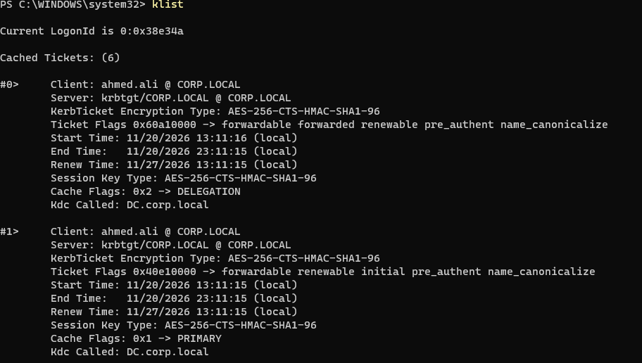
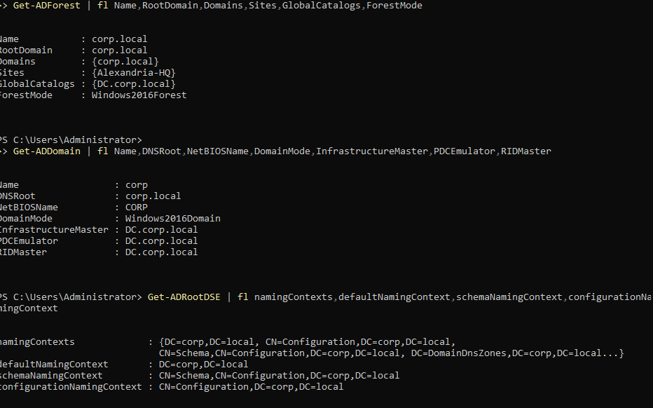
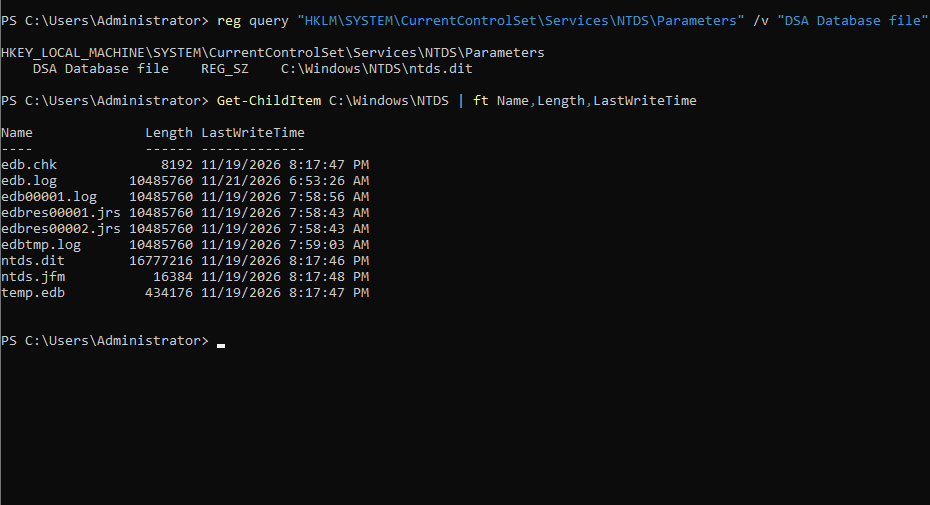
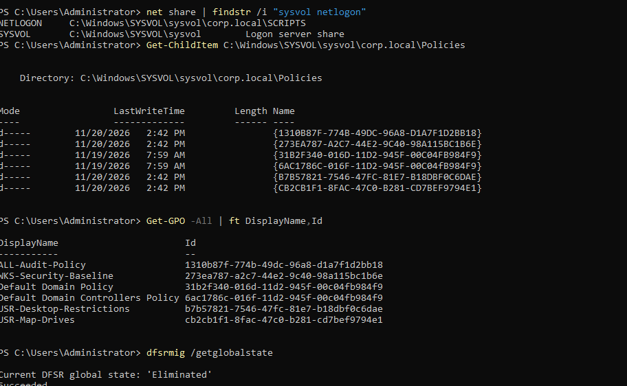

# Building an Active Directory Lab: Domain Services, Access Control, Group Policy, and Advanced Auditing

> A practical, expandable account of the `corp.local` lab. This document covers the implemented infrastructure, identity and resource management, Group Policy, and Advanced Audit Policy. Screenshots were captured at different points in the setup. A screenshot showing **Not Configured** illustrates the setting's location before the configuration was saved; it is not evidence of its final state.

## Goal and lab environment

The goal is to put core Active Directory concepts into practice. A client discovers a domain controller through DNS, receives its network settings through DHCP, joins the domain, signs in with a domain account, and accesses resources according to group membership and permissions. The environment is an isolated lab.

| Component | Lab value |
|---|---|
| Domain / NetBIOS | `corp.local` / `CORP` |
| Domain controller | `DC`, at `192.168.56.10` |
| Lab subnet | `192.168.56.0/24` |
| Server roles | AD DS, DNS, DHCP, and lab file shares |
| DHCP address pool | `192.168.56.100`–`192.168.56.200`; mask `255.255.255.0` |
| Joined workstation | `PC01` |
| Test user | `ahmed.ali@corp.local` |
| Separate administrator account | `adm-samy`, as shown in ADUC |
| AD site | `Alexandria-HQ` |

The original planning notes use `DC01` and `192.168.10.0/24`; the table above reflects the actual lab. One DNS Manager screenshot also shows a second interface at `10.0.2.15`. The internal domain controller address documented here is `192.168.56.10`.

## 1. Install AD DS and DNS and create the forest

**Purpose:** Install directory services and the DNS service used for domain controller discovery, then promote the server as the first domain controller in a new forest.

On the server, I ran PowerShell as Administrator:

```powershell
Set-DnsClientServerAddress -InterfaceAlias "Ethernet" -ServerAddresses 127.0.0.1
Install-WindowsFeature AD-Domain-Services, DNS -IncludeManagementTools
```

The graphical equivalent for installing the roles is **Server Manager → Manage → Add Roles and Features**, selecting **Active Directory Domain Services**, **DNS Server**, and their management tools. Installing the role alone does not create a domain: Server Manager subsequently offers **Promote this server to a domain controller**.

```powershell
Install-ADDSForest `
  -DomainName "corp.local" `
  -DomainNetbiosName "CORP" `
  -ForestMode WinThreshold -DomainMode WinThreshold `
  -InstallDns:$true `
  -SafeModeAdministratorPassword (Read-Host -AsSecureString "DSRM Password") `
  -Force
```

`WinThreshold` selects the Windows Server 2016 functional level. The Directory Services Restore Mode password is required for recovery and should be kept securely outside this article. After promotion and restart, the domain controller's full name is `dc.corp.local`.


### Validate the installation and troubleshoot DNS

I checked `Get-ADDomain`, `Get-ADForest`, `dcdiag /v`, `repadmin /replsummary`, and `nltest /dsgetdc:corp.local`. I also checked the `SYSVOL` and `NETLOGON` shares and the LDAP SRV record used for domain controller discovery:

```powershell
net share
Resolve-DnsName -Type SRV _ldap._tcp.dc._msdcs.corp.local
```

During troubleshooting, the screenshots show dynamic DNS registration errors and DFS Replication warnings in `dcdiag`. It would therefore be inaccurate to describe every initial check as passing. A later check shows both `SYSVOL` and `NETLOGON`, and `_ldap._tcp.dc._msdcs.corp.local` resolving to `dc.corp.local` at `192.168.56.10`. These results show that the shares were published and the DNS record resolved; they do not, by themselves, prove that a subsequent full `dcdiag` run had no DFSR warnings.


## 2. Configure DNS and DHCP

**DNS:** DNS Manager shows the `corp.local` and `_msdcs.corp.local` forward lookup zones and a reverse lookup zone for `192.168.56.0/24`. SRV records allow clients to locate AD services; the A record maps `dc.corp.local` to `192.168.56.10`. Useful checks are `Resolve-DnsName dc.corp.local` and `Resolve-DnsName -Type SRV _ldap._tcp.dc._msdcs.corp.local`. The existence of a reverse zone does not automatically prove that every host has a working PTR record.


**DHCP:** The active `LAN` scope leases addresses from `.100` to `.200` with an eight-day lease. Option 006 supplies DNS server `192.168.56.10`, and option 015 supplies the DNS domain name `corp.local`. This lets clients find AD DNS records without setting DNS manually on every device. The domain controller has a static address outside the lease pool.

```powershell
Get-DhcpServerv4Scope
Get-DhcpServerv4OptionValue -ScopeId 192.168.56.0
```

The command output screenshot shows the scope and its options. When reproducing the lab, avoid competing DHCP services on the virtual network and authorize the Windows DHCP server in AD.


## 3. Organize the AD site, OUs, and security groups

I renamed the default AD site to `Alexandria-HQ`. An AD site represents a network location. With multiple networks or domain controllers, sites help clients find appropriate controllers and shape replication. Renaming a site does not, on its own, create a subnet or a second controller.


Under `OU=Corp`, I created `Admins`, `Groups`, `ServiceAccounts`, `Computers` (including `Servers` and `Workstations`), and `Users` (including `IT`, `HR`, `Sales`, and `Finance`). Later screenshots also show `Legal`, `Marketing`, `Operations`, and `Support`. This layout makes it easier to target Group Policy and delegate administration to the relevant objects.


Security groups include global groups such as `GG_HR`, `GG_IT`, `GG_Sales`, and `GG_Finance`, and domain local groups such as `DL_HR_Share_RW`. The design follows **AGDLP**: put accounts in global groups, nest global groups in domain local groups, and grant resource permissions to domain local groups. A group name alone does not prove its membership; use the **Members** tab to verify the actual access chain.


I also separated daily work from administration by creating `adm-samy` under `Admins`. Placing a user account in that OU does not by itself grant domain administrator rights: its effective group membership should be checked on the **Member Of** tab.


## 4. Join the client and verify domain sign-in and Kerberos

**Purpose:** Confirm that DNS resolution and authentication work on a real client and that the computer object appears in `Workstations`. The original hostname `dc01.corp.local` did not resolve in the client screenshot; the actual name `dc.corp.local` resolved to `192.168.56.10`.

On the client:

```powershell
Rename-Computer -NewName PC01
Set-DnsClientServerAddress -InterfaceAlias "Ethernet" -ServerAddresses 192.168.56.10
ping DC.corp.local
Add-Computer -DomainName corp.local -Credential CORP\Administrator -Restart
```

The `PC01` computer object appears in the `Workstations` OU. I signed in as `ahmed.ali@corp.local` and checked the identity with `whoami /all`. `klist` showed Kerberos tickets, including a ticket-granting ticket and `cifs/DC.corp.local` service tickets. This connects the domain join to an authenticated user session and service access.




A separate sign-in screenshot says **Your account has been disabled**. That message indicates a disabled account, not proof of an account lockout policy taking effect. These are distinct account states.

## 5. File sharing and permission separation

I prepared the file server role and share folders, then tested access from the client. The preparation screenshot creates `C:\Shares\HR` and `C:\Shares\Sales`; the client screenshot displays shares named `HR` and `IT`. Accordingly, the access test below uses the names shown on the client rather than assuming that every created folder was published under the same name.

```powershell
Install-WindowsFeature FS-FileServer
New-Item -ItemType Directory C:\Shares\HR, C:\Shares\Sales
```

One recorded NTFS permission command for HR is:

```powershell
icacls C:\Shares\HR /grant "CORP\DL_HR_Share_RW:(OI)(CI)M" "CORP\Domain Admins:(OI)(CI)F" "SYSTEM:(OI)(CI)F"
```

`M` grants Modify, `F` grants Full Control, and `(OI)(CI)` propagates the ACE to child files and directories. For a reproducible setup, inspect both SMB share permissions and NTFS permissions: effective network access depends on both. Also review inherited ACLs if strict separation is required; the `/grant` command alone does not remove inheritance.

On the client, opening `\\DC.corp.local\HR` was denied, while the `IT` share could be opened. The test demonstrates differing access for these resources; the screenshots alone do not reveal every ACL entry or all of the user's group memberships.


> Running file shares on the domain controller keeps this small lab compact. A production design can separate server roles and permissions according to operational requirements.

## 6. Default and fine-grained password policies

The default domain policy sets a 12-character minimum, complexity, a 24-password history, a 90-day maximum and one-day minimum password age, and a lockout threshold of five attempts with a 15-minute duration and observation window:

```powershell
Set-ADDefaultDomainPasswordPolicy -Identity corp.local `
  -MinPasswordLength 12 -ComplexityEnabled $true `
  -PasswordHistoryCount 24 -MaxPasswordAge 90.00:00:00 `
  -MinPasswordAge 1.00:00:00 -LockoutThreshold 5 `
  -LockoutDuration 00:15:00 -LockoutObservationWindow 00:15:00
```

I then created `PSO_Admins` and assigned it to `Domain Admins`: a 16-character minimum, complexity, a 24-password history, a 60-day maximum age, and a threshold of three attempts with a 30-minute lockout duration and observation window. A fine-grained password policy allows different settings for selected users or groups. `Get-ADUserResultantPasswordPolicy` can show which policy applies to a specific account.


## 7. Group Policy and basic hardening

I created and linked four purpose-specific GPOs:

| GPO | Link target | Purpose |
|---|---|---|
| `WKS-Security-Baseline` | `OU=Workstations,OU=Computers,OU=Corp` | Workstation security settings |
| `USR-Desktop-Restrictions` | `OU=Users,OU=Corp` | User desktop restrictions |
| `USR-Map-Drives` | `OU=Users,OU=Corp` | User drive mappings |
| `ALL-Audit-Policy` | `corp.local` domain root | Domain-wide audit configuration, subject to GPO scope and application |

Creating and linking a GPO does not automatically configure its settings. The GUI settings documented in this stage include **All Removable Storage classes: Deny all access** under `Computer Configuration → Policies → Administrative Templates → System → Removable Storage Access`; **Windows Defender Firewall with Advanced Security** for the Domain, Private, and Public profiles; and **Deny log on locally** for `CORP\Domain Admins` under `Computer Configuration → Policies → Windows Settings → Security Settings → Local Policies → User Rights Assignment`. Computer settings should be placed in a GPO linked to the intended computer OU. Some screenshots show **Not Configured** because they were captured before the values were saved.

**Scope matters:** Do not apply **Deny log on locally** for `Domain Admins` to domain controllers without reviewing the link target; it could prevent local administrative sign-in on those servers. The policy editor screenshot identifies the group but does not establish the final GPO link or prove a sign-in test. Likewise, removable-storage restrictions should be tailored to the devices and operational needs of the environment.

To check what a workstation actually receives, run `gpupdate /force`, `gpresult /r`, or `gpresult /h C:\gp.html`. A GPMC link screenshot shows where the policy is linked, but a client-side resultant policy check is needed to verify application.


## 8. Advanced Audit Policy

The documented stage ends with configuration of `ALL-Audit-Policy` at:

`Group Policy Management → ALL-Audit-Policy → Edit → Computer Configuration → Policies → Windows Settings → Security Settings → Advanced Audit Policy Configuration → Audit Policies`

I configured **Success** and **Failure** for the listed audit subcategories, with **Success** for Process Creation to capture successful process launches. The event IDs below describe relevant events that can be generated after policy application and corresponding activity. They do **not** assert that those exact events were observed in the supplied screenshots.

| Category | Subcategory | Relevant events or purpose |
|---|---|---|
| Account Logon | Audit Kerberos Authentication Service | Ticket-granting ticket requests such as `4768` |
| Account Logon | Audit Kerberos Service Ticket Operations | Service ticket requests such as `4769` |
| Account Management | Audit User Account Management | User creation and modification such as `4720` and `4738` |
| Account Management | Audit Security Group Management | Security group membership changes, including `4728` and `4732` depending on group scope |
| Logon/Logoff | Audit Logon | Successful and failed sign-ins, `4624` and `4625`, on the system processing the sign-in |
| Logon/Logoff | Audit Account Lockout | Account lockout such as `4740` |
| DS Access | Audit Directory Service Changes | Directory object changes such as `5136`; relevant object SACLs may also be required |
| Privilege Use | Audit Sensitive Privilege Use | Certain sensitive privilege use events, including `4673` where applicable |
| Policy Change | Audit Audit Policy Change | Audit policy changes such as `4719` |
| Detailed Tracking | Audit Process Creation (Success) | Process creation events, `4688` |

**Include command lines in process creation events:** Under `Computer Configuration → Policies → Administrative Templates → System → Audit Process Creation`, set **Include command line in process creation events** to **Enabled**. Audit Process Creation must also be enabled for the command line to appear in Security event `4688`. Command lines can contain sensitive arguments, so access to these logs should be controlled.

**PowerShell Script Block Logging:** Under `Computer Configuration → Policies → Administrative Templates → Windows Components → Windows PowerShell`, set **Turn on PowerShell Script Block Logging** to **Enabled**. Script blocks can be recorded in `Microsoft-Windows-PowerShell/Operational`, including event `4104`. The exact contents depend on executed activity; this setting should not be described as guaranteeing that every encoded or in-memory action is captured in full.


## 9. Inspect the directory internals and validate Kerberos

These additional checks document how the installed domain is organized and how authentication appears on the client and the domain controller. They are observations from the completed lab, while a separate `Concepts/` directory holds the conceptual explanations in the author’s own words.

### Forest, domain, and naming contexts

```powershell
Get-ADForest | Format-List Name,RootDomain,Domains,Sites,GlobalCatalogs,ForestMode
Get-ADDomain | Format-List Name,DNSRoot,NetBIOSName,DomainMode,InfrastructureMaster,PDCEmulator,RIDMaster
Get-ADRootDSE | Format-List namingContexts,defaultNamingContext,schemaNamingContext,configurationNamingContext
```

The output shows a single forest and root domain, `corp.local`, the site `Alexandria-HQ`, and global catalog `DC.corp.local`. Both the forest and domain functional levels are Windows Server 2016. The Infrastructure Master, PDC Emulator, and RID Master roles listed in the screenshot are on `DC.corp.local`; the screenshot does not list every FSMO role.

RootDSE reports the domain naming context `DC=corp,DC=local`, the schema naming context `CN=Schema,CN=Configuration,DC=corp,DC=local`, and the configuration naming context `CN=Configuration,DC=corp,DC=local`. In ADSI Edit, I opened these three contexts. The Configuration screenshot also shows cross-references for the DNS application partitions `DomainDnsZones` and `ForestDnsZones`. This verifies the directory structures present in this one-domain forest; it does not demonstrate a child domain or a trust.




### Locate the AD database

```powershell
reg query "HKLM\SYSTEM\CurrentControlSet\Services\NTDS\Parameters" /v "DSA Database file"
Get-ChildItem C:\Windows\NTDS | Format-Table Name,Length,LastWriteTime
```

The registry value points to `C:\Windows\NTDS\ntds.dit`. The directory listing shows `ntds.dit`, `edb.log`, `edb.chk`, and `temp.edb`, among other files. This is evidence of the database path and the files present; no database copy or IFM operation is claimed here. The database and its copies warrant tight access control because they contain sensitive directory credential material.



### Match SYSVOL policy folders with GPOs

```powershell
net share | findstr /i "sysvol netlogon"
Get-ChildItem C:\Windows\SYSVOL\sysvol\corp.local\Policies
Get-GPO -All | Format-Table DisplayName,Id
dfsrmig /getglobalstate
```

The screenshots show `SYSVOL` and `NETLOGON`, the policy directories, their corresponding GPO IDs, and a DFSR migration global state of **Eliminated**. `Eliminated` means the domain’s SYSVOL migration has completed its transition away from FRS; it does not, on its own, establish that every DFSR health check is clean.

| Policy directory GUID | GPO display name |
|---|---|
| `1310B87F-774B-49DC-96A8-D1A7F1D2BB18` | `ALL-Audit-Policy` |
| `273EA787-A2C7-44E2-9C40-98A115BC1B6E` | `WKS-Security-Baseline` |
| `31B2F340-016D-11D2-945F-00C04FB984F9` | `Default Domain Policy` |
| `6AC1786C-016F-11D2-945F-00C04FB984F9` | `Default Domain Controllers Policy` |
| `B7B57821-7546-47FC-81E7-B18DBF0C6DAE` | `USR-Desktop-Restrictions` |
| `CB2CB1F1-8FAC-47C0-B281-CD7BEF9794E1` | `USR-Map-Drives` |

The GUIDs match the listings in the supplied screenshot; the table does not claim that `GptTmpl.inf` was opened or that SYSVOL was searched for embedded passwords.



### Recreate the Kerberos ticket flow

On `PC01`, the `ahmed.ali` session ran `klist purge`, and `klist` immediately afterwards displayed **Cached Tickets: (0)**. After accessing the `IT` share and running `klist` again, the screenshots show tickets for `krbtgt/CORP.LOCAL` and `cifs/DC`. The client used the actual server name `DC`, not the obsolete `DC01` from the original plan.

```powershell
klist purge
klist
dir \\DC\IT
klist
```

The domain controller’s Security log was filtered for event IDs `4768` and `4769`, and entries of both types appear. The screenshot shows the event list, not the detailed fields for encryption type, client address, or service name. No test using a share’s IP address, NTLM fallback, or `klist tgt` output is documented in these screenshots.


## Conclusion

This lab now has a working single-domain AD foundation: `corp.local` on `DC`, DNS records and DHCP settings for the `192.168.56.0/24` network, structured OUs and groups, a domain-joined `PC01`, and observed domain sign-in and Kerberos tickets. Resource access tests showed a denied HR share and an accessible IT share for the client session. Password policies, linked GPOs, and Advanced Audit Policy were configured, while the additional checks exposed the directory naming contexts, database location, SYSVOL-to-GPO mapping, and `4768`/`4769` event list.

The evidence also has clear boundaries. An early diagnostic showed DNS and DFSR warnings; a later screenshot of shares and DNS resolution does not replace a fresh full health check. Some policy screenshots were taken before settings were saved, and GPO links alone do not prove client-side application. The lab report records completed actions and observed results without treating planned experiments as completed. Concept explanations are maintained separately under `Concepts/`.
